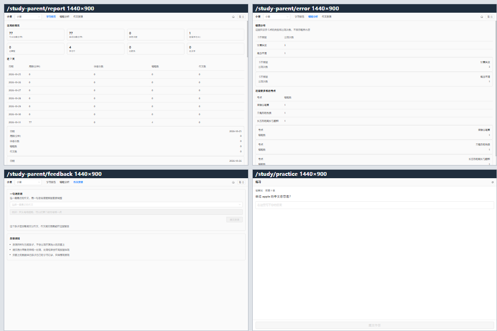
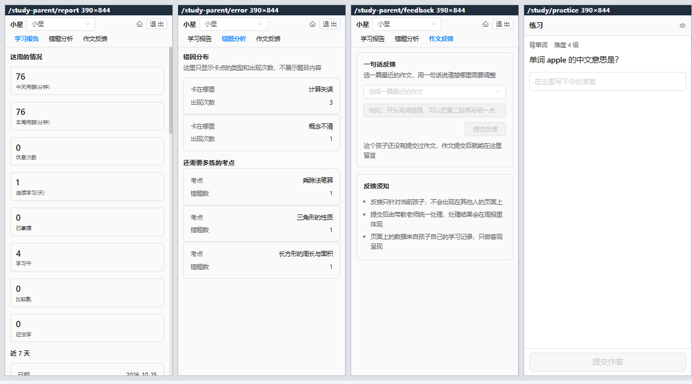

<!--META
{
  "brand": "jeecg-study",
  "title": "用户手册 · 系统功能使用说明",
  "kicker": "面向家长与孩子的操作手册",
  "subtitle": "jeecg-study 用户手册。覆盖两类用户（家长 / 孩子）的登录方式、学习端 7 个功能页与家长端 3 个页面的完整操作说明、界面解读与常见问题处置。手册中的界面截图取自 2026-10-31 的真实浏览器取证（1440 / 768 / 390 三视口），未上线的功能在正文中明确标注。",
  "meta_line": "20261031 · V1.0 · 用户手册",
  "accent": "#52c41a",
  "facts": [
    {"v": "10", "k": "已上线页面"},
    {"v": "7", "k": "学习端页面"},
    {"v": "3", "k": "家长端页面"},
    {"v": "106", "k": "后端接口"},
    {"v": "3", "k": "视口适配"},
    {"v": "0", "k": "公开比较"}
  ],
  "side_title": "手册导航",
  "side": [
    {"label": "手册说明", "pct": 100, "color": "#52c41a", "note": "必读"},
    {"label": "认识系统", "pct": 100, "color": "#52c41a", "note": "2 页"},
    {"label": "登录与身份", "pct": 100, "color": "#52c41a", "note": "3 页"},
    {"label": "学习端功能", "pct": 100, "color": "#52c41a", "note": "4 节"},
    {"label": "家长端功能", "pct": 100, "color": "#52c41a", "note": "3 页"},
    {"label": "家庭与孩子", "pct": 60, "color": "#b07d12", "note": "待上线"},
    {"label": "常见问题", "pct": 100, "color": "#52c41a", "note": "8 问"},
    {"label": "现状与边界", "pct": 100, "color": "#52c41a", "note": "必读"}
  ],
  "sections": [
    {"id": "intro",    "nav": "手册说明",       "num": "01", "tag": "怎么读"},
    {"id": "system",   "nav": "认识系统",       "num": "02", "tag": "两类用户"},
    {"id": "login",    "nav": "登录与身份",     "num": "03", "tag": "入门"},
    {"id": "practice", "nav": "学习端·练习",   "num": "04", "tag": "作答"},
    {"id": "wordgram", "nav": "学习端·背单词与语法", "num": "05", "tag": "V1 / V3"},
    {"id": "gamewrite","nav": "学习端·玩法与写作", "num": "06", "tag": "V3 / V4"},
    {"id": "eye",      "nav": "学习端·护眼",   "num": "07", "tag": "R-03"},
    {"id": "parent",   "nav": "家长端三页",     "num": "08", "tag": "只读"},
    {"id": "family",   "nav": "家庭与孩子管理", "num": "09", "tag": "接口就绪"},
    {"id": "faq",      "nav": "常见问题",       "num": "10", "tag": "8 问"},
    {"id": "status",   "nav": "功能现状与边界", "num": "11", "tag": "已上线/待上线"}
  ],
  "footer": [
    {"t": "jeecg-study · 用户手册 V1.0"},
    {"t": "2026-10-31"},
    {"t": "界面截图取自 2026-10-31 浏览器真机取证"},
    {"t": "问题反馈：03-测试验证/03-缺陷跟踪/"}
  ]
}
-->

## 手册说明

手册说明：写给使用 jeecg-study 的家长与孩子，说明每个功能「怎么用、看到的是什么、遇到问题怎么办」。

### 1.1 本手册的读者

| 角色 | 你关心什么 | 建议重点读 |
|---|---|---|
| **家长** | 孩子的学习情况怎么看、怎么留反馈、怎么管家庭与孩子账号 | 第 2、3、8、9、10 章 |
| **孩子**（初中及以上） | 每个学习模块怎么用、护眼怎么设 | 第 3、4、5、6、7、10 章 |
| 初次接触者 | 系统整体长什么样 | 第 1、2 章 |

### 1.2 三个必须先知道的前提

1. **数据是按「孩子」隔离的。** 同一个孩子在不同设备上看到的学习记录一致；不同孩子之间的数据**互不可见**。家长看到的是**自己关联的孩子**的数据，看不到别人的孩子。
2. **系统不做公开比较。** 任何页面都不会出现「排名」「超过了多少同学」这类内容；家长之间也**互相不可见**、不可对比。家长端看到的是**客观趋势与状态**。
3. **答案不会提前出现。** 练习页必须**先自己作答**，才能看到解析与思路；系统也不会把答案藏在页面里等你翻。

### 1.3 界面长什么样

系统有两套完全不同的界面，互不混用：

| 界面 | 使用者 | 特征 |
|---|---|---|
| **学习端** | 孩子 | 全屏独立界面，顶部一条窄栏（模块名 + 连续学习天数 + 护眼状态图标），底部固定一条**主操作按钮**；**没有**侧边菜单、没有管理端顶栏；主题**锁定浅色** |
| **家长端** | 家长 | 全屏独立界面，顶部一条窄栏（当前孩子 + 切换 + 3 项页面导航 + 退出）；**只读**，不提供新增 / 编辑 / 删除入口 |

> 界面在 **390px 手机 / 768px 平板 / 1440px 桌面**三档宽度下都完整可用；窄屏下表格会自动变成卡片，不需要左右拖动。

## 认识系统

认识系统：两类用户、三类内容、四个学习模块。

### 2.1 两类用户分别能看到什么

| 身份 | 登录方式 | 能看到的数据 |
|---|---|---|
| **家长** | 底座原生账号密码登录 | **只读**：自己关联孩子的学习报告、错题分析、作文反馈 |
| **孩子** | 家庭码 + PIN 两步登录 | **只有自己**的学习数据与护眼设置 |
| 管理员 | 底座管理员账号 | 全部（用于内容维护与排障） |

### 2.2 三类内容的区别

系统里的数据分三类，**界面上也做了区分**：

| 类型 | 例子 | 归属 |
|---|---|---|
| **内容**（全局共享） | 单词、语法点、题目、母题、写作情境、玩法题库、语法例句 | 所有孩子**共用同一份**，不会每个孩子复制一份 |
| **行为**（按孩子隔离） | 作答记录、错题、复习排期、用眼记录、错句收藏 | **只属于某一个孩子**，按孩子严格隔离 |
| **关系** | 家庭、家庭码、家长↔孩子关联 | 决定「谁能看到谁的数据」 |

### 2.3 学习端的四个学习模块

| 模块 | 页面 | 解决什么问题 |
|---|---|---|
| **通用练习** | 练习 | 做完题才知道对错，错题自动进错题池 |
| **背单词** | 背单词 | 课内 / 课外双线，按「认识 / 模糊 / 忘记 / 熟知」四档反馈安排复习 |
| **英语语法** | 英语语法 · 语法玩法 | 语法点 + 句子变形 + 找错句 |
| **语文写作** | 语文写作 · 写作情境 | 三步训练流：提纲 → 初稿 → 对照式批改 |

## 登录与身份

登录与身份：家长用账号密码，孩子用家庭码加 PIN，两步完成。

### 3.1 家长登录

1. 打开系统地址，进入**登录页**。
2. 输入家长账号与密码，登录成功后进入管理端首页。
3. 点击顶部菜单进入**学习报告 / 错题分析 / 作文反馈**，即进入家长端界面。

> 家长端是**只读**的：你可以在顶部条切换孩子、切换页面、退出，但**看不到**任何管理性的操作按钮。

### 3.2 孩子登录（两步）

孩子的账号由家长在「孩子档案」里创建，登录需要**家庭码 + PIN**：

| 步骤 | 操作 | 说明 |
|---|---|---|
| 1 | 输入**家庭码** | 家庭码由家长创建/重置，形如 `STU026`；**只有本次显示**，需当面告知孩子 |
| 2 | 从候选列表里**选择孩子** | 家庭码正确时返回该家庭下的孩子候选 |
| 3 | 输入 **PIN** | 默认 4 位数字；**连错 5 次锁定 10 分钟** |

> **家庭码错了会提示「家庭码不正确」**；这不会泄露家庭是否存在。
> **PIN 连续输错 5 次会锁定 10 分钟**，锁定期间无法登录；家长可在「孩子档案」里重置 PIN。

**孩子登录页怎么进**：地址 `/study/kid/login`，**不需要先登录**（这是唯一免登录的页面）。

> 候选列表里只显示**头像和昵称**——不会显示账号名、生日、年级，也不会显示别的孩子。
> 家庭码错误统一提示「家庭码不正确」，**不区分「没有这个家庭」和「码输错了」**。
> PIN 错误提示里**不显示剩余次数**，避免被用来试探。
> **断网时不会说「家庭码不正确」**：页面会明确提示「网络好像断了，检查一下网络后点重试」并给「重试」入口——
> 网络问题说成「码输错了」，会让孩子以为自己输错了、家庭码失效了。

### 3.2.1 孩子端界面形态

孩子端**复用学习端布局**：顶部是轻量顶栏（48px），**主操作固定在底部主操作条**（拇指可达区），
一屏只留**一个**主按钮（步骤①「下一步」/ 步骤②「进入」）。
浅色主题固定，不跟随系统暗色开关；登录阶段不启动用眼计时（登录后才开始计时）。

### 3.3 退出

| 界面 | 退出入口 |
|---|---|
| 家长端 | 顶部条最右侧的**「退出」**按钮（会二次确认） |
| 学习端 | 学习端没有独立退出按钮，由家长在孩子档案中停用，或清除本机登录状态 |

## 学习端·练习

学习端·练习：先作答，才给判定与解析。

### 4.1 界面结构

| 区域 | 内容 |
|---|---|
| 顶部窄栏 | 当前模块名「练习」+ 连续学习天数 + 护眼状态图标 |
| 主体 | **题干**（如「单词 apple 的中文意思是?」）+ 作答输入框 |
| 底部主按钮 | **提交作答**（一屏只放一个主操作） |

### 4.2 操作流程

1. **读题**：主体区显示题干与输入框。
2. **作答**：在输入框里写下你的答案。练习页支持文字输入，不支持拍照。
3. **提交**：点底部「提交作答」。
4. **看判定**：系统用**确定性规则**判定对错（不是 AI 判的），并显示判定依据。
5. **逐步展开**（顺序固定，不可跳过）：
   - 「**先看母题思路**」→ 展示解题思路；
   - 「**看解析**」→ 展示完整解析。

### 4.3 三个必须知道的行为

| 行为 | 说明 |
|---|---|
| **不能先看答案** | 未作答时请求解析会被拒绝（错误码 4003），页面上的解析区**初始就不在页面上**，不是「藏起来」 |
| **判对错不靠 AI** | 判定结果会标明来源；涉及分数的判断一定有确定性规则或人工兜底 |
| **错题自动入库** | 答错的题会进入**统一错题池**，并要求你选一个**错因**（不选会提示「缺少错因」） |

### 4.4 错因标签（必填）

答错后系统会让你选错因，常见五类：

| 错因 | 含义 |
|---|---|
| 概念不清 | 知识点本身没掌握 |
| 看错题意 | 题读错了 |
| 步骤漏了 | 会做但漏步骤 |
| 计算失误 | 会做但算错 |
| 表达不准 | 意思对但表达有问题 |

> 选错因不是「扣分」，它决定**这道题下次什么时候、以什么形式再出现给你**。

## 学习端·背单词与语法

学习端·背单词与语法：两条线的单词 + 带考纲标签的语法点。

### 5.1 背单词

**界面结构**：顶部窄栏（模块名「背单词」）、主体（单词释义 + 例句挖空）、底部主按钮（作答）。

#### 背单词的两种线

| 线 | 说明 | 入口 |
|---|---|---|
| **课内线** | 跟着教材单元走，一个单元一个单元闯关 | 背单词首页 → 选课内单元 |
| **课外线** | 教材外的词，按到期时间排队 | 背单词首页 → 课外词线 |

#### 四档反馈（决定下次怎么复习）

| 反馈 | 含义 | 对复习参数的影响 |
|---|---|---|
| **认识** | 很熟 | 记忆强度 +0.35，遗忘速率不变 |
| **模糊** | 半会半不会 | 记忆强度 +0.10，遗忘速率 ×1.2 |
| **忘记** | 完全不会 | 记忆强度归 0，遗忘速率 ×1.6 |
| **熟知** | 熟到不用再见 | 记忆强度 +0.5，遗忘速率 ×0.8 |

> 这四档**不是对/错**——「认识」和「熟知」都是正向反馈，只影响复习排期，不产生任何分数。

#### 其他功能

- **熟词测试**：把已经判定掌握的词挑出来做一遍，达标的不再进入复习队列。
- **课内 → 课外升级**：课内背错的词会被标记，优先出现在课外线的复习项里。
- **复习欠账**：当天的复习没做完时，不发新词，会提示「先把昨天的复习做完」。

### 5.2 英语语法

**语法点列表**：主页显示**语法点标题 + 中考题型标签**（单选 / 完形 / 语法填空 / 书面表达等），点击进入详情。

**句子变形器**：输入一句中文，得到 5 种表达：

| 形态 | 用途 |
|---|---|
| 直译版 | 按中文语序直译 |
| 地道口语版 | 日常口语 |
| 书面版 | 书面表达 |
| 考试安全版 | 中考写作里最稳妥的写法 |
| **错误示范版** | **明确标错**（标注「✗ 不要这样写」），是**讲解素材**，不是范例 |

> 语法域**零 AI 依赖**：变形只查语料库，错误检测走确定性规则表。

## 学习端·玩法与写作

学习端·玩法与写作：四种玩法，以及带情境库的写作三步流。

### 6.1 语法玩法（四个模式）

在「语法玩法」页面顶部切换模式：

| 模式 | 玩法 | 你要做什么 |
|---|---|---|
| **语境例句** | 看同一个词在不同语境里的用法 | 浏览**课文 / 真题 / 原声素材**三类例句（与背单词**共用同一批例句**） |
| **句子侦探** | 四句话里有一句不对，把它找出来 | 指出第几句有问题 → 系统判定并给出「最小讲解 + 同类例句 + 反例」三件套 |
| **变形闯关** | 只给中文意思，自己写英文 | 写下英文句子 → 系统判定；写错的句子**自动进错句收藏馆** |
| **我的错句收藏馆** | 读统一错题池，按错因过滤 | 查看 / 筛选自己写错过的句子 |

> **取题阶段不给答案**：句子侦探只给四句话，不告诉你错的是哪一句；变形闯关只给中文意思，不给参考表达。讲解与参考表达都在**你提交之后**才出现。

### 6.2 语文写作（三步训练流）

| 步骤 | 你要做 | 系统做什么 |
|---|---|---|
| 1. **提纲** | 写下这一步要写什么 | 校验提纲结构；**提纲没通过就不允许提交初稿**（错误码 4002） |
| 2. **初稿** | 写下正文 | 拆解成**六层**结构存档 |
| 3. **对照式批改** | 看批改结果 | **只给最多 3 条温和差异建议**，不给分数、不代写 |

### 6.3 写作情境库（给处境，不给金句）

情境库是**写作素材**的入口，流程是三步：

| 步骤 | 界面 | 说明 |
|---|---|---|
| 1 | **先挑一个主题** | 6 个主题，每个主题下有**多条不同处境**（年龄段、细节线索、难度各不相同） |
| 2 | **挑一种处境** | 每一处只给处境、年龄段、细节线索、提示题与限制条件；**没有可以直接抄走的句子** |
| 3 | **写你自己的经历** | 必填「写你身上真实发生过的事」；提示题引导你写当天的动作 |

> **限制条件**会明确写出来：「只写自己发生过的事」「不要写成口号 / 不要抄别人作品里的句子」。

## 学习端·护眼

学习端·护眼：蓝光过滤、休息提醒、远眺建议，三项都是真指标不是营销词。

### 7.1 护眼设置页

| 卡片 | 内容 | 可操作 |
|---|---|---|
| **蓝光过滤** | 「屏幕调暖一点，晚上看书舒服些」 | ✅ 开关 + 保存 |
| **休息提醒** | 提醒间隔 + 护眼状态 | 只读（间隔由**家长**配置） |
| **远眺一下** | 「看向 6 米外的地方，保持 20 秒」 | 提示 |

底部主按钮：**保存设置**。

> **孩子端不显示用眼时长数字**，只显示状态 —— 这是刻意的设计，避免让孩子盯着时长数字焦虑。

### 7.2 休息提醒遮罩（不可绕过）

用眼达到提醒间隔（默认 15 分钟，由家长配置）后，学习端会弹出**遮罩**，提示你远眺休息。

| 动作 | 结果 |
|---|---|
| 点「**我休息好了**」 | 遮罩解除，继续学习 |
| 不确认 | 遮罩**一直保留**，页面被挡住 |

> 遮罩的触发与解除**全部由服务端判定**（`restRequired`），页面不自行计时 —— 所以它不会因为刷新、切页或改本地时间而失效。
> 遮罩不是「强制弹窗广告」，它就是产品的**硬指标**（红线 R-03）。

### 7.3 断网时

学习端任一页面断网时，顶部会出现可读提示「网络好像断了，检查一下网络后点重试」，并提供**「重试」**按钮。网络恢复后点重试会重新发起请求，**数据不会丢失、不会重复提交**。

> 当前版本**不做离线补交**（范围决策，非缺陷）。

## 家长端三页

家长端三页：只读看趋势、可留一句话反馈，看不到任何排名。

> 本章讲的是家长端的**三个只读数据页**。家长端另外还有三个**管理页**
> （家庭成员 / 孩子档案 / 关联管理），见第 9 章。

### 8.1 家长端界面结构

顶部条从左到右：

| 元素 | 作用 |
|---|---|
| **孩子昵称** | 当前查看的孩子 |
| **切换下拉** | 在**你关联的孩子**之间切换（只能切到已关联的） |
| **6 项导航** | 学习报告 / 错题分析 / 作文反馈 / 家庭成员 / 孩子档案（当前页高亮） |
| **退出** | 二次确认后退出登录 |

> 家长端**没有侧边菜单**，顶部条就是唯一的页面入口；窄屏下顶部条换两行显示。
> 「关联管理」不在导航里——它是「孩子档案」的下一级，从档案页里的按钮进去。

### 8.2 学习报告

| 区块 | 内容 |
|---|---|
| **这周的情况** | 今天用眼分钟数、本周用眼分钟数、休息次数、连续学习天数、已掌握 / 学习中 / 比较熟 / 还没学 各多少 |
| **近 7 天** | 逐日：用眼分钟数、休息次数、错题数、作文数 |
| **掌握情况** | 按掌握度分档的知识点数量 |
| **常见的卡点** | 反复出错的考点 |
| **还需要多练的考点** | 待加强的知识点排行 |

> 窄屏（≤992px）下表格自动转成卡片，横向不拖动。

### 8.3 错题分析

| 区块 | 内容 |
|---|---|
| 错题统计 | 错题总数、已订正数、当前待复习数、平均间隔天数 |
| **错因分布** | 按五类错因统计错题数、错题率 |
| **复习建议** | 各错因对应的复习建议 |

### 8.4 作文反馈

| 步骤 | 操作 |
|---|---|
| 1 | 从下拉里**选择一篇最近的作文**（列表只给摘要，**不含正文**） |
| 2 | 在输入框里写**一句话**反馈（≤100 字），如「开头写得挺稳，可以把第二段再写细一点」 |
| 3 | 点「提交反馈」 |

下方「**反馈须知**」会明确列出边界：反馈必须对应具体一篇作品；一次只写一句，别写成长篇评语；不评价孩子的努力程度，只指出下一步的方向。

> 反馈**绑定具体作品**，这样孩子打开那篇作文时能看到你的话。
> 家长端**看不到**其他家长的反馈，孩子之间、家长之间都不互相可见。

图 1 · 桌面 1440×900 —— 家长端三页（学习报告 / 错题分析 / 作文反馈）与练习页

图 2 · 移动 390×844 —— 家长端顶部条换两行显示，页面内容完整、无遮挡

## 家庭与孩子管理

家庭与孩子管理：家长自己就能管——建家庭、加孩子、改档案、配关联、重置码。

### 9.1 三个页面

| 页面 | 路由 | 能做什么 |
|---|---|---|
| **家庭成员** | `/study-parent/family` | 改家庭名称、邀请/移除家长、重置家庭码 |
| **孩子档案** | `/study-parent/child` | 改昵称/头像/性别/生日/年级、重置 PIN、停用孩子 |
| **关联管理** | `/study-parent/child/<孩子的业务 id>/relations` | 给这个孩子加/解绑家长 |

> 三个页面都在**家长端顶部条**里（家长端没有侧边菜单，顶部条就是唯一的页面入口）。
> 「孩子档案」操作的是**顶部条当前选中的那个孩子**；换孩子只需用顶部条的下拉切换。
> 成员 / 关联列表在**窄屏（≤992px）自动转成卡片**，不会左右拖动；断网时页面给出可读提示与「重试」入口，
> **不会把「断网」显示成「找不到这个孩子」**。

### 9.2 各功能与状态

| 功能 | 说明 | 状态 |
|---|---|---|
| 创建家庭 | 第一个加入的家长自动成为家庭所有者（OWNER） | 接口 ✅ / 界面 ✅（由管理员在后台建） |
| 添加 / 移除家长成员 | 按底座用户名添加；移除后立即失去查看权限 | 接口 ✅ / 界面 ✅ |
| 重置家庭码 | 生成新家庭码，**明文仅本次返回一次** | 接口 ✅ / 界面 ✅ |
| 新增孩子档案 | 同时创建孩子账号并设置 PIN（**PIN 明文仅本次返回**） | 接口 ✅ / 界面 ⬜（当前在后台建） |
| 编辑孩子档案 | 昵称 / 头像 / 年级 / 生日 | 接口 ✅ / 界面 ✅ |
| 停用孩子档案 | 停用后该孩子无法登录 | 接口 ✅ / 界面 ✅ |
| 重置孩子 PIN | 生成新 PIN，**明文仅本次返回** | 接口 ✅ / 界面 ✅ |
| 关联 / 解除关联家长 | 一家长多孩子、一孩子多家长均可 | 接口 ✅ / 界面 ✅ |

> 「新增孩子档案」目前只有接口与后台入口，**家长端页面还没有「新建孩子」按钮**——
> 现有页面做的是「维护已有孩子」，新建仍是管理员在后台完成。

### 9.3 账号与密钥的三条硬规则

| 规则 | 说明 |
|---|---|
| **家庭码明文只返回一次** | 库里只存 HMAC 摘要，看不到原码；丢了只能重置 |
| **PIN 明文只返回一次** | 库里只存 PBKDF2 派生值；忘了只能重置 |
| **重置后才生效** | 重置家庭码 / PIN 立即生效，旧码旧 PIN 立刻失效 |

> 孩子账号复用底座用户体系（`sys_user` + 角色 `study_kid`），家长用底座原生账号 + 角色 `study_parent`。

## 常见问题

常见问题：八个高频问题与处置办法。

### 10.1 常见问题速查

| # | 问题 | 原因 | 怎么办 |
|---|---|---|---|
| 1 | 家长端看不到某个孩子的数据 | 该孩子**未关联**到你的账号 | 由家庭所有者在「关联管理」里把你和孩子关联上；关联解除后立即失效 |
| 2 | 提示「无权访问」（错误码 4010） | 你访问的不是自己关联的孩子 | 切换到你关联的孩子；这是**故意的安全设计**，不是故障 |
| 3 | 孩子登录提示「家庭码不正确」 | 家庭码输错或已被重置 | 找家庭所有者确认或重置 |
| 4 | 孩子 PIN 连错 5 次后登不上 | 触发了 **10 分钟锁定** | 等 10 分钟，或由家长重置 PIN |
| 5 | 护眼遮罩一直不消失 | 还没点「我休息好了」 | 点「我休息好了」解除；遮罩**故意不能绕过** |
| 6 | 护眼页不显示「提醒间隔」 | 家长还没配过间隔 | 由家长在家长端配置；未配置时显示「还没有设置提醒间隔」 |
| 7 | 页面提示「网络好像断了」 | 断网 | 按提示点「重试」；网络恢复后数据不会丢、不会重复提交 |
| 8 | 手机上看表格变成卡片 | 窄屏（≤992px）**自动**转卡片 | 正常行为，不需要横向拖动 |

### 10.2 仍然拿不到数据时

按顺序排查这三处：

1. **是不是切换错了孩子** —— 家长端顶部条左侧显示当前孩子昵称，先确认。
2. **是不是还没关联** —— 用「孩子概览」接口确认孩子在你的关联列表里。
3. **是不是该数据尚未产生** —— 例如「近 7 天」要当天有学习记录才有内容；「错题分布」要先有错题。

## 功能现状与边界

功能现状与边界：哪些已经能用，哪些还没上线，以及我们刻意不做的事。

### 11.1 已上线界面一览

| 端 | 页面 | 路由 |
|---|---|---|
| 学习端 | 练习 | `/study/practice` |
| 学习端 | 背单词 | `/study/word` |
| 学习端 | 英语语法 | `/study/grammar` |
| 学习端 | 语法玩法 | `/study/grammar/game` |
| 学习端 | 语文写作 | `/study/writing` |
| 学习端 | 写作情境 | `/study/writing/scenario` |
| 学习端 | 护眼设置 | `/study/eye` |
| 孩子端 | 孩子登录（两步） | `/study/kid/login`（免登录） |
| 家长端 | 学习报告 | `/study-parent/report` |
| 家长端 | 错题分析 | `/study-parent/error` |
| 家长端 | 作文反馈 | `/study-parent/feedback` |
| 家长端 | 家庭成员 | `/study-parent/family` |
| 家长端 | 孩子档案 | `/study-parent/child` |
| 家长端 | 关联管理 | `/study-parent/child/<code>/relations` |
| 管理端 | 上下文配置 | `/study/manage/context` |
| 管理端 | 坐标树 | `/study/manage/coordinate` |
| 管理端 | 考点维护 | `/study/manage/coordinate/<code>` |
| 管理端 | 考点版本历史 | `/study/manage/coordinate/<code>/history` |
| 管理端 | 题目维护 | `/study/manage/question` |
| 管理端 | 母题维护 | `/study/manage/mother` |
| 管理端 | 词表维护 | `/study/manage/word` |
| 管理端 | 语法点维护 | `/study/manage/grammar` |
| 管理端 | 拆解库维护 | `/study/manage/writing` |

### 11.2 管理端内容维护页：能改什么、不能改什么

9 个管理端页面统一挂在侧边栏的「**内容维护**」下，**只有管理员看得到**（家长端不出现）。

| 页面 | 现在能做什么 | 说明 |
|---|---|---|
| 上下文配置 | **可改**：教材版本、年级、学段、省份、护眼提醒间隔 | 上下文按**孩子**存，页面顶部先选孩子 |
| 坐标树 | 浏览整棵考点树，点节点进考点维护 | 只读导航 |
| 考点维护 | **可改**：题型、分值权重、关联错因、绑定母题 | 考点名称与学科属于树结构，不在这一页改 |
| 考点版本历史 | 看历史版本 | 只读 |
| 题目维护 | 看**全局题库的内容分布**（每个考点挂了多少题/词/母题/语法点/拆解） | 见下方「为什么不是错题池」 |
| 母题维护 | 看母题列表与五段结构详情 | 只读 |
| 词表维护 | 看词条（按课内/课外切换） | 只读 |
| 语法点维护 | 看语法点与规则/例句/反例 | 只读 |
| 拆解库维护 | 看拆解条目与分层内容 | 只读 |

> **为什么「题目维护」不是错题池**：错题池是**按孩子隔离**的行为数据（「这个孩子错了哪些题」），
> 把它列在管理端等于在内容维护台里暴露单个孩子的学习行为。
> 这一页因此改看**全局内容**：题库在各个考点下的分布。

> **词表页看不到拼写**：拼写就是拼写题的答案，按产品红线不随词表接口下发。
> 管理端靠「**释义 + 单元 + 业务 id**」定位词条。

> **还能改的只有 2 页**：上下文配置与考点维护。
> 其余 7 页目前是**内容浏览**——对应的编辑接口还没有，页面里不提供修改入口，
> 宁可少给一个按钮，也不要给一个点了会失败或者改坏数据的按钮。

### 11.3 我们刻意不做的四件事

| 不做 | 原因 |
|---|---|
| **不提供公开排名或同龄比较** | 保护孩子的比较焦虑（红线 R-04） |
| **不提供家长之间的互相查看或对比** | 多家长共用一个家庭时，不制造家长间的比较（红线 R-04 强化） |
| **不提供家庭内部的横向比较** | 「谁的孩子更…」这类表述一律不出现 |
| **不代写、不给分数** | 批改只给最多 3 条温和差异建议；涉及分数的判断走确定性规则 + 人工兜底（红线 R-02） |

### 11.4 数据安全承诺

| 承诺 | 技术落点 |
|---|---|
| 越权一律返回 **4010**（不用 404，避免被用来探测资源是否存在） | 服务端按 `child_id` 强制过滤 |
| 家长只看到自己关联的孩子 | 家长与孩子多对多关系表决定可见范围 |
| 内容全局共享、行为按孩子隔离 | 同一份题库给孩子复用，但作答记录各存各的 |
| 密码类信息不可逆 | 家庭码用 HMAC 摘要、PIN 用 PBKDF2 派生，明文只返回一次 |
